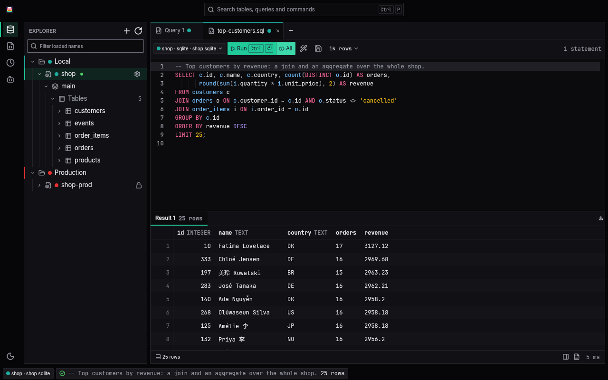
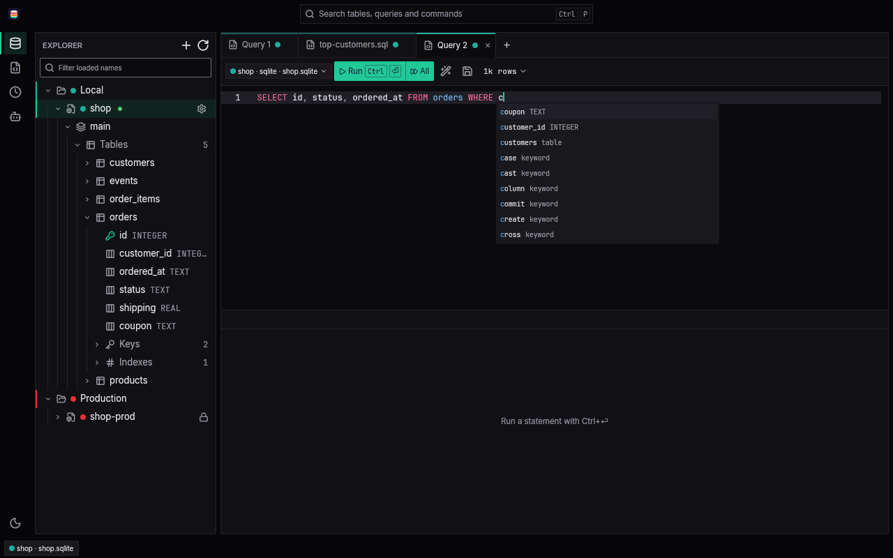
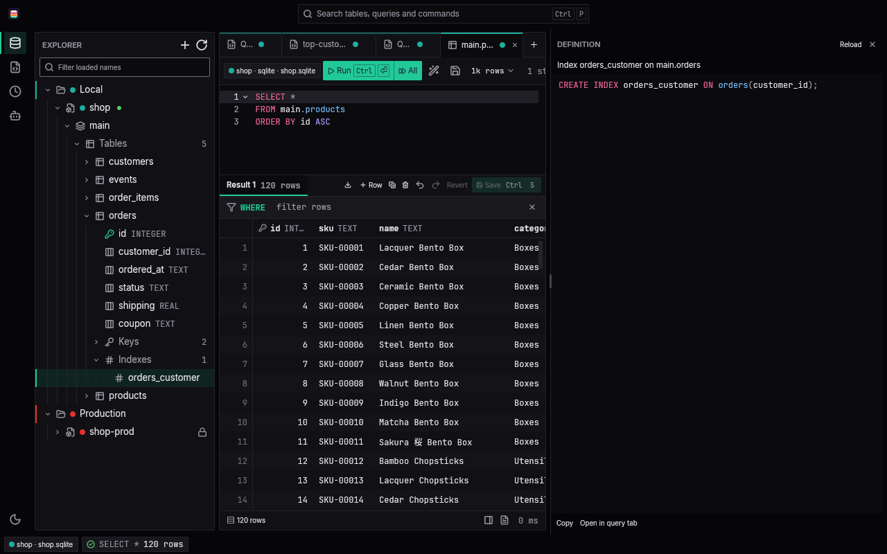
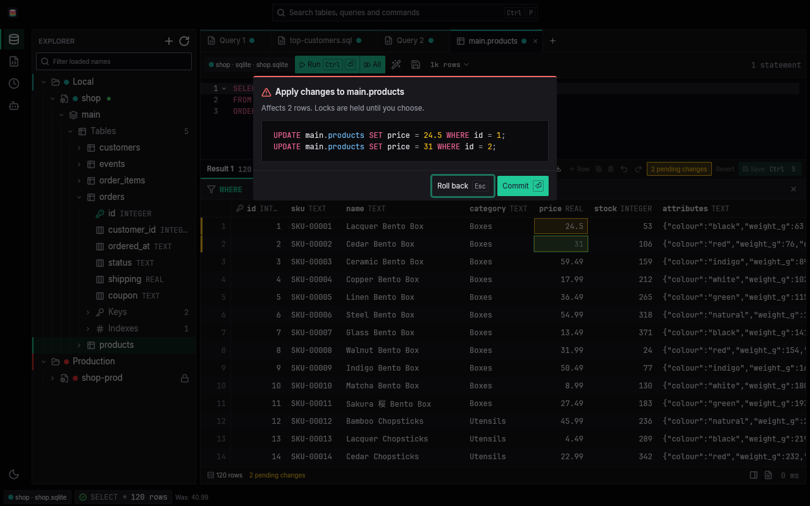
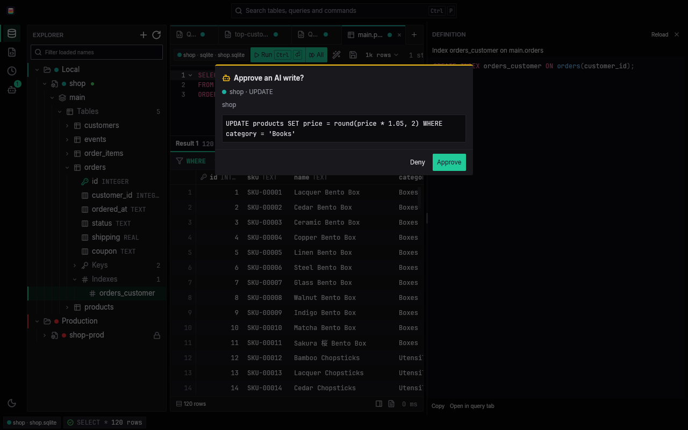

# Dbento

**A fast, native database client.** Dbento is free and open source, written in Rust and drawn on the GPU: no Electron, no webview. It comes as a desktop app, a command line, and an MCP server that gives an AI client careful access to your databases. The name is db + bento: data in neat compartments.



## Why Dbento

- **Native and fast.** The desktop app is built on GPUI and rendered through the GPU. Results stream into a virtualized grid, so a large result scrolls as smoothly as a small one.
- **Your workspace is a folder.** Connections live in `dbento.toml` and saved queries in plain `.sql` files, so a team can review them in git. No password is ever written to a file.
- **The database enforces safety.** A read-only connection is opened read-only by the database itself, rather than by Dbento guessing from the SQL whether a statement writes.
- **AI access with you in the loop.** The MCP server is read-only by default. A write runs only after you approve that exact call in the desktop app, and the AI can never approve itself.

## Supported databases

| Database | `engine` in `dbento.toml` |
| --- | --- |
| PostgreSQL | `postgres` |
| SQLite | `sqlite` |
| MySQL and MariaDB | `mysql` |
| SQL Server | `mssql` |
| DuckDB | `duckdb` |

DuckDB is a default Cargo feature of the command line and the app; a build with `--no-default-features` leaves it out and skips its C++ compile. Support for MongoDB and SurrealDB is in progress: their connection settings are read, but connecting to either is not possible yet.

## Features

### A result grid that keeps up

Results stream in as the database sends them, into a virtualized grid that fetches the next batch as you scroll. A row limit (1k, 10k, 100k or 1M rows, or none, with only a memory budget) stops collecting and marks the result truncated. Dbento never rewrites your SQL to add a `LIMIT`, and a type it does not know is shown, never turned into NULL. Copy cells as TSV, CSV, JSON, Markdown or `INSERT` statements, export loaded rows to CSV or JSON, and step through one row in the record view.

### An editor that knows your schema

SQL highlighting, formatting, and completion of schemas, tables, columns and keywords from the connection's live catalog. Queries open in tabs, saved queries are plain `.sql` files, every run lands in a searchable history, and the command palette (Ctrl+P, Cmd+P on macOS) finds tables, saved queries and commands. A running query can be cancelled.



### An explorer down to the indexes

The schema tree shows tables, views, materialized views and foreign tables, and under each one its columns, keys, indexes, checks and triggers, plus types and routines on Postgres. Open any object to read its definition, copy it, or open it in a query tab.



### Editing you review before it lands

Edit cells, add rows and delete rows in a browsed table. Changes are staged, then applied in one transaction with typed parameters, after a prompt that says how many rows they affect and asks you to commit or roll back. Rows without a primary key are found by `ctid` and `xmin` on Postgres and by `rowid` on SQLite, and a row someone else changed or deleted in the meantime is marked instead of overwritten.



### AI access through MCP

`dbento mcp` serves a workspace to an AI client over MCP on stdio, with nine tools: `list_connections`, `list_schemas`, `list_tables`, `describe_table`, `query`, `explain`, `list_saved_queries`, `read_saved_query` and `execute`.

- `query` always runs read-only. It returns 100 rows by default and at most 1,000, about 64 KiB, under a statement timeout of 30 seconds by default.
- `explain` shows the plan of one statement on Postgres and SQLite in the same read-only session, so an AI can preview an `UPDATE` or `DELETE` without running it. `ANALYZE` is refused.
- `list_saved_queries` and `read_saved_query` read the `.sql` files under the workspace's `queries/` folder and nothing outside it, not even through a symlink.
- `execute` waits until you approve that exact call in the desktop app, once. When you deny a call you can type a reason, and the AI gets it back with the denial.

Query results are passed to the AI as untrusted data. The app's approvals panel shows the command to connect your AI client.



### Safety the database enforces

- A `read_only` connection runs every statement in `BEGIN READ ONLY` on Postgres and opens SQLite and DuckDB read-only, so the database itself refuses a write.
- On Postgres the server still lets a few things through: functions that open their own connections, such as `dblink_exec` where the dblink extension is installed, and admin functions whose effect is not transactional, such as `pg_terminate_backend`, `pg_cancel_backend` and `pg_stat_reset`. For a production database, use a role without the privileges the rest need; it can still cancel or terminate backends of its own role.
- A MySQL or MariaDB `read_only` connection, and every MCP session on one, runs each statement in `START TRANSACTION READ ONLY`. The server still lets a few things through: `SELECT ... INTO OUTFILE` or `DUMPFILE`, `SET GLOBAL` and `SET PERSIST`, `FLUSH`, `GET_LOCK`, and an existing stored procedure that commits and then writes. For a production database, use an account without the FILE, RELOAD, SYSTEM_VARIABLES_ADMIN or SUPER privileges and without EXECUTE on such procedures, ideally one granted only SELECT.
- On SQL Server, give a `read_only` connection a `read_only_user` (a login that can only read) and the database enforces it. Without one the session is best effort: Dbento fences each batch in a transaction it rolls back and refuses the batches it can parse as writes, but a login with the rights can get past the fence with a hidden commit. `list_connections` states the level of each connection to an AI client.
- A connection tagged red is marked as production in the tab line and the status bar.
- `UPDATE` or `DELETE` without `WHERE`, `DROP` and `TRUNCATE` ask before they run.
- Postgres statements are parsed with `pg_query`, so a write hidden in a CTE is still caught. A statement the parser cannot handle is never blocked for that reason alone.

### Also

- Light and dark themes, or follow the system.
- `dbento import datagrip`, `dbento import dbeaver` and `dbento import beekeeper` bring over connections and saved queries from DataGrip, DBeaver and Beekeeper Studio, and saved passwords go to the keychain.
- Try it without a database server: `make demo` (see [Try the demo](#try-the-demo)).

## How it works

### One core, thin shells

All of the logic lives in `dbento-core`, a library with no UI: the workspace format, the keychain, the database drivers behind one async interface, streamed results, and the safety checks. Three thin shells call only its public API:

| Crate | What it is |
| --- | --- |
| `dbento-cli` | The `dbento` command line, which also hosts the MCP server. |
| `dbento-mcp` | The MCP server itself, built on rmcp. |
| `dbento-app` | The `dbento-app` desktop app, built on GPUI. |

### A workspace is a folder

A workspace is any folder with a `dbento.toml` in it. Connections live in that file, and saved queries in `queries/<connection>/*.sql`, so a query file knows which connection it runs on. Folders group connections and give them a color.

```toml
dbento = 1

[connections.app-dev]
engine = "postgres"
host = "localhost"
database = "app"
user = "app"

[connections.app-prod]
engine = "postgres"
host = "db.example.com"
database = "app"
user = "readonly"
read_only = true
color = "red"

[connections.local]
engine = "sqlite"
path = "data/app.db"
```

### Secrets stay out of files

No password is ever written to `dbento.toml`. A server connection's secret is stored in the OS keychain (the Secret Service on Linux, Keychain on macOS, Credential Manager on Windows), and only the secret, never the whole connection URL. When the keychain has no entry, Dbento reads the environment variable `DBENTO_SECRET_<NAME>`, the connection name in upper case with `-` as `_` (so `app-prod` reads `DBENTO_SECRET_APP_PROD`). A connection can also name its own variable with `secret = { env = "PGPASSWORD" }`, or say it needs none with `secret = "none"`.

## Download

| System | Desktop app | Command line |
| --- | --- | --- |
| Linux x86_64 | [.deb](https://github.com/PhongGuy/dbento/releases/latest/download/dbento-app_amd64.deb) · [AppImage](https://github.com/PhongGuy/dbento/releases/latest/download/dbento-app_x86_64.AppImage) | [tar.gz](https://github.com/PhongGuy/dbento/releases/latest/download/dbento-x86_64-unknown-linux-gnu.tar.gz) |
| Linux arm64 | [.deb](https://github.com/PhongGuy/dbento/releases/latest/download/dbento-app_arm64.deb) · [AppImage](https://github.com/PhongGuy/dbento/releases/latest/download/dbento-app_aarch64.AppImage) | [tar.gz](https://github.com/PhongGuy/dbento/releases/latest/download/dbento-aarch64-unknown-linux-gnu.tar.gz) |
| macOS Apple silicon | [Dbento_aarch64.dmg](https://github.com/PhongGuy/dbento/releases/latest/download/Dbento_aarch64.dmg) | [tar.gz](https://github.com/PhongGuy/dbento/releases/latest/download/dbento-aarch64-apple-darwin.tar.gz) |
| macOS Intel | [Dbento_x86_64.dmg](https://github.com/PhongGuy/dbento/releases/latest/download/Dbento_x86_64.dmg) | [tar.gz](https://github.com/PhongGuy/dbento/releases/latest/download/dbento-x86_64-apple-darwin.tar.gz) |
| Windows x64 | [Installer (.exe)](https://github.com/PhongGuy/dbento/releases/latest/download/dbento-app_x64-setup.exe) | [zip](https://github.com/PhongGuy/dbento/releases/latest/download/dbento-x86_64-pc-windows-msvc.zip) |

No release has been published yet, so these links start working with the first one. Until then, [build from source](#build-from-source). The macOS and Windows packages have not yet been tested on those systems.

Releases will be listed on the [releases page](https://github.com/PhongGuy/dbento/releases), with checksums. See [Install notes](#install-notes) for the first launch on macOS and Windows.

### Install notes

A release holds these files, where `<v>` is the version. Each one also has a copy without the version in its name, which is what the download links above point to.

| Platform | Desktop app | Command line |
| --- | --- | --- |
| Linux x86_64 | `dbento-app_<v>_amd64.deb`, `dbento-app_<v>_x86_64.AppImage` | `dbento-<v>-x86_64-unknown-linux-gnu.tar.gz` |
| Linux arm64 | `dbento-app_<v>_arm64.deb`, `dbento-app_<v>_aarch64.AppImage` | `dbento-<v>-aarch64-unknown-linux-gnu.tar.gz` |
| macOS Apple silicon | `Dbento_<v>_aarch64.dmg` | `dbento-<v>-aarch64-apple-darwin.tar.gz` |
| macOS Intel | `Dbento_<v>_x86_64.dmg` | `dbento-<v>-x86_64-apple-darwin.tar.gz` |
| Windows x64 | `dbento-app_<v>_x64-setup.exe` | `dbento-<v>-x86_64-pc-windows-msvc.zip` |

**Linux:** the `.deb` installs both `/usr/bin/dbento` and `/usr/bin/dbento-app`. The AppImage cannot put `dbento` on your `PATH`, so AppImage users also take the CLI archive for their architecture.

**macOS:** the app is ad-hoc signed and not notarized, so Gatekeeper blocks the first open. Move `Dbento.app` to `/Applications` before the first launch, then clear the quarantine flag:

```sh
xattr -dr com.apple.quarantine /Applications/Dbento.app
```

**Windows:** SmartScreen warns before the installer runs. Files built without the project's signing certificate carry `-unsigned` in their versioned names, such as `dbento-app_<v>_x64-setup-unsigned.exe`; the unversioned copy drops the marker, so the download link works either way.

**Checksums:** every package and archive carries `THIRD-PARTY-NOTICES.html`, the licenses of the crates it is built from. One `SHA256SUMS` file covers every file, the unversioned copies included; check your downloads with:

```sh
sha256sum -c --ignore-missing SHA256SUMS
```

## Build from source

You need:

- Rust 1.99 or newer (the workspace's `rust-version`), from [rustup](https://rustup.rs).
- A C and C++ compiler and libclang, for the bundled `pg_query` parser and DuckDB.
- On Linux, the system libraries GPUI draws with. On Debian or Ubuntu:

  ```sh
  sudo apt-get install pkg-config libfontconfig-dev libfreetype-dev libwayland-dev \
    libx11-xcb-dev libxkbcommon-x11-dev libvulkan1 libegl1 libclang-dev
  ```

From a checkout, run:

    make

This builds with 4 jobs (`make JOBS=8` for more) and installs `dbento` (the command line) and `dbento-app` (the desktop app) with `cargo install`. On Linux it also adds a desktop entry and the icon under `~/.local/share`. `make PREFIX=/some/dir` installs the binaries under `/some/dir/bin` instead, and `make uninstall` removes everything again. On macOS only the binaries are installed. On Windows, or to install without `make`, run the two installs by hand:

    cargo install --locked --path crates/dbento-cli
    cargo install --locked --path crates/dbento-app

To build without installing, `cargo build --release` puts both binaries in `target/release`.

## Quick start

### Try the demo

    make demo

This opens the app on a small shop: customers, products, orders and 200,000 events in SQLite, with saved queries to open with Ctrl+O (Cmd+O on macOS) from the workspace's `queries/` folder (top customers, a scroll through every event, an `UPDATE` without `WHERE`, a slow query to cancel, and a write that the read-only `shop-prod` connection refuses). No database server or keychain is needed. Each run copies `examples/demo` fresh to `~/.cache/dbento-demo/workspace` and builds `shop.sqlite` from its `seed.sql`, and the app keeps its state in `~/.cache/dbento-demo/state`, so nothing you do in the demo reaches the repo or your own app settings.

### Your own workspace

Create a workspace in a new folder:

```sh
mkdir my-databases && cd my-databases
dbento init
```

This writes `dbento.toml` and an empty `queries/` folder. Add a connection to `dbento.toml`, such as `app-dev` from the example [above](#a-workspace-is-a-folder), then store its password in the keychain. `dbento secret set` prompts for it, or reads the first line of stdin, and never takes it from the command line:

```sh
dbento secret set app-dev
dbento connections
```

Run SQL on a connection, or run a saved query file. A file under `queries/app-dev/` runs on `app-dev`; pass `--conn` for a file anywhere else:

```sh
dbento query app-dev "select * from users order by created_at desc"
dbento run queries/app-dev/recent-orders.sql
dbento run report.sql --conn app-dev --format csv > report.csv
```

Both commands take `--format table|json|csv`, `--max-rows N`, `--read-only`, `--timeout 30s`, and `--yes` to run an `UPDATE` or `DELETE` without `WHERE`, a `DROP` or a `TRUNCATE` without asking. Every command finds the nearest `dbento.toml` above the working directory, or takes `--workspace <dir>`.

### The desktop app

Open the app on a workspace by passing its folder:

```sh
dbento-app ~/my-databases
```

### Connect an AI client

Register `dbento mcp` as a stdio MCP server in your AI client. Most clients take a JSON entry like this one:

```json
{
  "mcpServers": {
    "dbento": {
      "command": "dbento",
      "args": ["--workspace", "/home/you/my-databases", "mcp"]
    }
  }
}
```

`--connection <name>` (repeatable) exposes only the connections you name, and `--timeout <secs>` sets the statement timeout for every call (30 by default). Keep the desktop app open on the same workspace to approve or deny the writes the AI asks for.

## Development

### Make targets

| Target | What it does |
| --- | --- |
| `make check` | The merge gate: `cargo fmt --check`, clippy with warnings as errors, and the full test suite. |
| `make pilot-check` | Builds and runs the gpui-pilot tests in `tools/dbento-pilot`, which drive the real app. |
| `make script-test` | The bash suites under `scripts/tests`. |
| `make workflows-lint` | actionlint over `.github/workflows`. |
| `make icons-check`, `make notices-check`, `make windows-check` | The icon exports, the third-party notices, and a Windows type-check through mingw. |
| `make xwin-check`, `make xwin-build` | An msvc check and release-style build from Linux through cargo-xwin; `xwin-build` compiles shaders at runtime, so it is not for shipping. |
| `make package` | The Linux CLI archive, `.deb` and AppImage, verified, in `target/dist/linux`. |
| `make screenshots` | Regenerates the screenshots in `assets/screenshots` from the demo workspace under gpui-pilot. |
| `make demo` | Opens the app on the demo workspace. |

`make pilot-check` and `make screenshots` need the `gpui-pilot` server on your `PATH`, or `GPUI_PILOT_BIN` naming it. Install it with:

```sh
cargo install --locked --git https://github.com/PhongGuy/gpui-pilot --tag v0.1.0 gpui-pilot
```

### Tests against real databases

Tests against database servers start containers through testcontainers. With rootless podman, point it at the podman socket:

    export DOCKER_HOST=unix://$XDG_RUNTIME_DIR/podman/podman.sock

`cargo xtask db up` starts a matrix of Postgres versions with the Chinook dataset (`--datasets` adds pagila, airlines or the stress tables) and prints the `export` lines that point the tests at it; `cargo xtask db down` removes the containers. To skip containers, set `DBENTO_PG_URL` to a running server.

### Contributing

Issues and pull requests are welcome. Before you open a pull request, run `make check` (and `make pilot-check` for a change to the app), and write commit messages in the [Conventional Commits](https://www.conventionalcommits.org/en/v1.0.0/) style, such as `fix(core): ...`. Releasing is described in [RELEASING.md](RELEASING.md).

## License

Dbento is dual-licensed under either of

- the MIT license ([LICENSE-MIT](LICENSE-MIT)), or
- the Apache License, Version 2.0 ([LICENSE-APACHE](LICENSE-APACHE)),

at your option. The bundled fonts and icons keep their own licenses, in [licenses/](licenses/).
