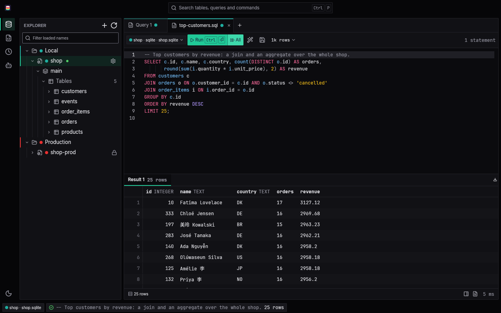
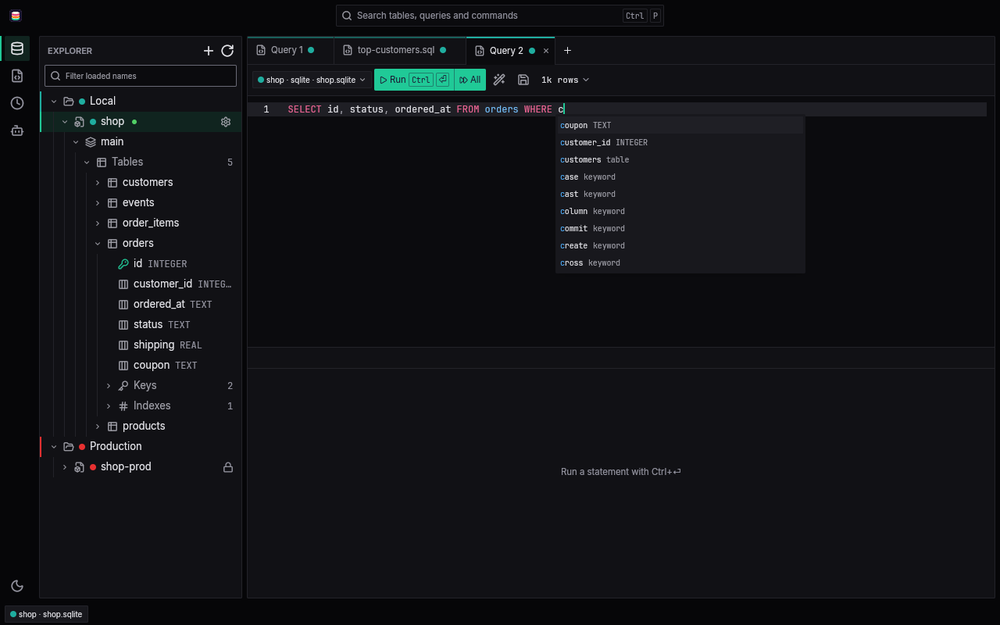
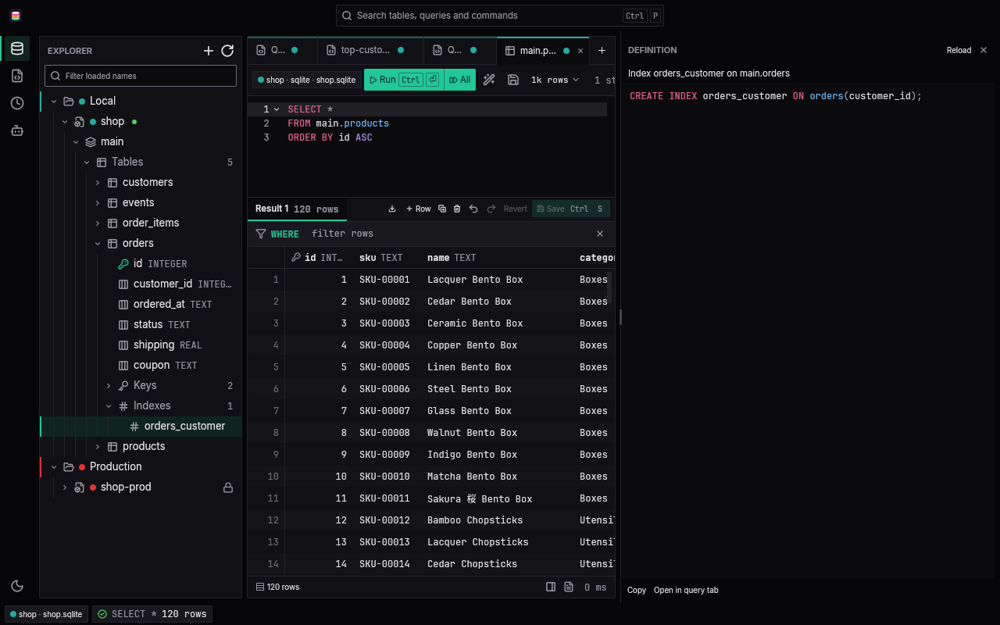
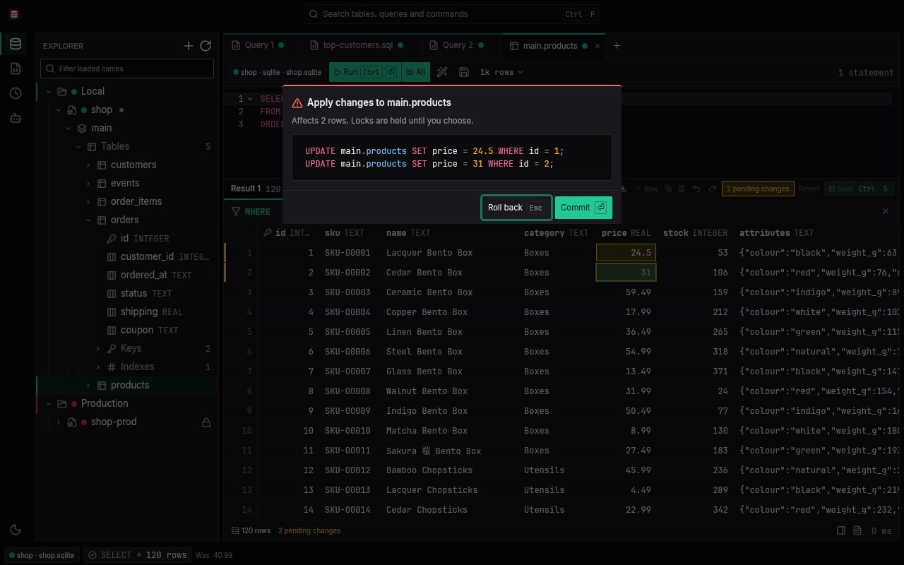
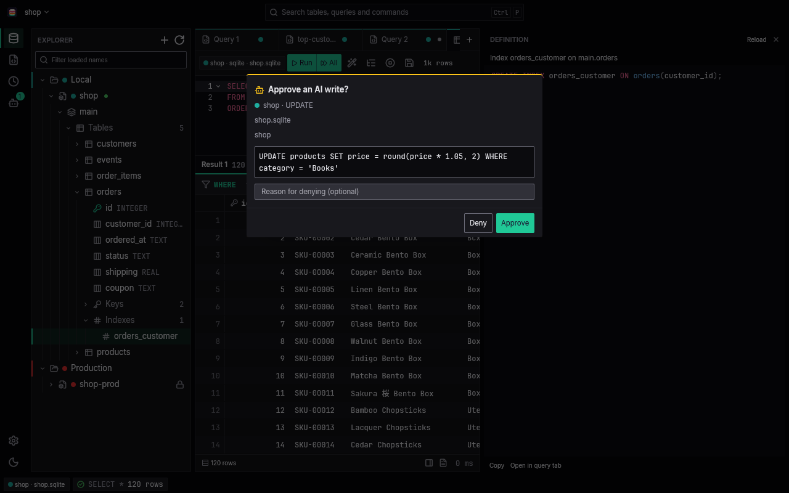

#  Dbento

**A fast, native database client.** Dbento is free and open source, written in Rust and drawn on the GPU: no Electron, no webview. It comes as a desktop app, a command line, and an MCP server that gives an AI client read-only access to your databases by default. It speaks SQL to Postgres, SQLite, MySQL, SQL Server and DuckDB, and each NoSQL store's own language to MongoDB, SurrealDB, Redis and DynamoDB, and it browses Amazon S3 and S3-compatible object stores read-only. Server connections can go through an SSH tunnel. The name is db + bento: data in neat compartments.



## Why Dbento

- **Native and fast.** The desktop app is built on GPUI and rendered through the GPU. Results stream into a virtualized grid, so a large result scrolls as smoothly as a small one.
- **Your workspace is a folder.** Connections live in `dbento.toml` and saved queries in plain text files, so a team can review them in git. No password is ever written to a file.
- **The database enforces safety.** A read-only connection is opened read-only by the database itself, rather than by Dbento guessing from the SQL whether a statement writes.
- **AI access with you in the loop.** The MCP server is read-only by default. A write runs only after you approve that exact call in the desktop app, and the AI can never approve itself.

## Supported databases

| Database | `engine` in `dbento.toml` | Query language | Saved query files |
| --- | --- | --- | --- |
| PostgreSQL | `postgres` | SQL | `.sql` |
| SQLite | `sqlite` | SQL | `.sql` |
| MySQL and MariaDB | `mysql` (or `mariadb`) | SQL | `.sql` |
| SQL Server | `mssql` (or `sqlserver`) | T-SQL | `.sql` |
| DuckDB | `duckdb` | SQL | `.sql` |
| MongoDB | `mongodb` (or `mongo`) | a subset of mongosh: `find`, `aggregate`, `insertOne`, `updateMany` and more | `.js` |
| SurrealDB | `surrealdb` (or `surreal`) | SurrealQL, over WebSocket | `.surql` |
| Redis and Valkey | `redis` (or `valkey`) | Redis commands, one per line | `.redis` |
| Amazon DynamoDB | `dynamodb` (or `dynamo`) | PartiQL | `.partiql` |
| Amazon S3 and S3-compatible stores | `s3` | S3 browse commands, one per line or `;`: `ls`, `ls [-r] s3://bucket[/prefix]`, `stat s3://bucket/key` and `cat s3://bucket/key` | `.s3` |

Other engines are tracked in the [issue tracker](https://github.com/PhongGuy/dbento/issues).

## Features

### A result grid that keeps up

Results stream in as the database sends them, into a virtualized grid that fetches the next batch as you scroll. A row limit (1k, 10k, 100k or 1M rows, or none, with only a memory budget) stops collecting and marks the result truncated. Dbento never rewrites your SQL to add a `LIMIT`, and a type it does not know is shown, never turned into NULL. Copy cells as TSV, CSV, JSON, Markdown or `INSERT` statements, export loaded rows to CSV, TSV or JSON, and step through one row in the record view.

### An editor that knows your schema

SQL highlighting, formatting, and completion of schemas, tables, columns and keywords from the connection's live catalog. Queries open in tabs, saved queries are plain `.sql` files, every run lands in a searchable history, and the command palette (Ctrl+P, Cmd+P on macOS) finds tables, saved queries and commands. Ctrl+/ (Cmd+/) toggles line comments, a tab with unsaved changes is marked and asks before it closes, and a running query can be cancelled.



### An explorer down to the indexes

The schema tree shows tables, views, materialized views and foreign tables, and under each one its columns, keys, indexes, checks and triggers, plus types and routines on Postgres and SQL Server and routines on MySQL. Open an object to read its definition, where the engine gives one, copy it, or open it in a query tab.



### Documents, keys, items and objects

The NoSQL stores and S3 share the same explorer, editor and grid, each in its own language.

- **MongoDB:** databases and collections, with fields inferred from a sample of documents, and indexes. Opening a collection runs its `find()`. Columns come from the first documents, and fields that appear later land in a `(more fields)` column.
- **Redis and Valkey:** each DB index with its key count, and the keys grouped into folders by `:`. Keys are listed with a `SCAN` walk that shows each key's type and TTL, and the filter takes a pattern plus `type:<kind>`. Opening a string, hash, list, set, sorted set or stream shows its value in a paged grid, with its type, length and TTL. Command completion comes from the server's `COMMAND DOCS`.
- **DynamoDB:** one schema per region, with tables, their key attributes, indexes, and attributes sampled from items. Opening a table or an index runs a PartiQL `SELECT`, and attributes beyond the first items land in a `(more attributes)` column.
- **SurrealDB:** the namespace's databases and their tables, read from `INFO` and sampled rows, with fields, indexes and triggers. Opening a table runs `SELECT * FROM` it.
- **S3:** buckets, then prefixes and objects one level at a time, 500 entries per page with a Load more row. A bucket or prefix opens its `ls` listing in a query tab, and a prefix or object copies its key or `s3://` URL. Opening an object gives it its own tab: a metadata line with its URL, size, last write, etag, storage class and content type, and a preview of its first MiB as text, pretty-printed JSON or a `hexdump -C` style hex view, whichever its bytes allow. Download saves an object to a file you choose, with its progress in a strip above the status bar and a button to cancel it.

### Editing you review before it lands

Edit cells, add rows and delete rows in a browsed Postgres or SQLite table. Changes are staged, then applied in one transaction with typed parameters, after a prompt that says how many rows they affect and asks you to commit or roll back. Rows without a primary key are found by `ctid` and `xmin` on Postgres and by `rowid` on SQLite, and a row someone else changed or deleted in the meantime is marked instead of overwritten.



### AI access through MCP

`dbento mcp` serves a workspace to an AI client over MCP on stdio, with ten tools: `list_connections`, `list_databases`, `list_schemas`, `list_tables`, `describe_table`, `query`, `explain`, `list_saved_queries`, `read_saved_query` and `execute`.

- `query` always runs read-only, one statement in the connection's own language: SQL, a mongosh statement, SurrealQL, one Redis command, PartiQL, or one S3 command. Redis commands in the `@dangerous`, `@blocking`, `@scripting` and `@pubsub` categories are refused. It returns 100 rows by default and at most 1,000, about 64 KiB, under a statement timeout of 30 seconds by default.
- On S3, `list_schemas` lists the buckets (the connection's `buckets`, else every bucket `ListBuckets` returns), and `query` takes `ls`, `ls [-r] 's3://bucket/prefix'`, `stat 's3://bucket/key'` or `cat 's3://bucket/key'`, with keys in single quotes. `cat` returns an object's first bytes: text whole up to about 64 KiB, other bytes as hex cut at 2 KiB, with the object's size and whether it was cut. `list_tables` and `describe_table` are refused with a pointer to `ls`, there is no download, and `execute` answers `not_a_write` to every S3 command, since none of them writes.
- `explain` shows the plan of one statement on Postgres, SQLite, MySQL and MariaDB in the same read-only session, so an AI can preview an `UPDATE` or `DELETE` without running it. On MySQL and MariaDB the read-only session refuses a plan of `INSERT`, `UPDATE`, `DELETE` or `REPLACE`, so only reads can be explained there. `ANALYZE` is refused.
- `list_saved_queries` and `read_saved_query` read the saved query files (`.sql`, `.js`, `.surql`, `.redis`, `.partiql`, `.s3`) under the workspace's `queries/` folder and nothing outside it, not even through a symlink.
- `execute` never runs a write on its own. The first call files a request and answers `approval_required`; you approve or deny that exact call in the desktop app, and the AI's retry of the same call then runs it once or gets the denial. When you deny a call you can type a reason, and the AI gets it back with the denial. If the connection's target or session settings change after you approve, the old approval never runs against the changed connection; the AI gets `connection_changed` with a new request to approve.

Query results are passed to the AI as untrusted data. The app's approvals panel shows the command to connect your AI client.



### Safety the database enforces

- A `read_only` connection runs every statement in `BEGIN READ ONLY` on Postgres and opens SQLite and DuckDB read-only, so the database itself refuses a write. A `read_only` DuckDB connection also has file access off, so `read_csv` and Parquet reads of local files do not work there.
- On Postgres the server still lets a few things through: functions that open their own connections, such as `dblink_exec` where the dblink extension is installed, and admin functions whose effect is not transactional, such as `pg_terminate_backend`, `pg_cancel_backend` and `pg_stat_reset`. For a production database, use a role without the privileges the rest need; it can still cancel or terminate backends of its own role.
- A MySQL or MariaDB `read_only` connection, and every MCP session on one, runs each statement in `START TRANSACTION READ ONLY`. The server still lets a few things through: `SELECT ... INTO OUTFILE` or `DUMPFILE`, `SET GLOBAL` and `SET PERSIST`, `FLUSH`, `GET_LOCK`, and an existing stored procedure that commits and then writes. For a production database, use an account without the FILE, RELOAD, SYSTEM_VARIABLES_ADMIN or SUPER privileges and without EXECUTE on such procedures, ideally one granted only SELECT.
- On SQL Server, give a `read_only` connection a `read_only_user` (a login that can only read) and the database enforces it. Without one the session is best effort: Dbento fences each batch in a transaction it rolls back and refuses the batches it can parse as writes, but a login with the rights can get past the fence with a hidden commit. `list_connections` states the level of each connection to an AI client.
- On MongoDB, Dbento reads the user's privileges when it connects. A user that can only read is enforced by the server; for any other user Dbento refuses every command it cannot show reads.
- On SurrealDB each statement runs in a transaction that is cancelled, and a VIEWER login is enforced by the server. At either level, stored logic reached from a `SELECT` can still advance sequences, call `http::*` functions or write files, and a root OWNER or anonymous login can run `ALTER SYSTEM`.
- On Redis and Valkey, Dbento checks the user's ACL against the server's command table when it connects. A user whose ACL refuses every write is enforced by the server; otherwise Dbento refuses writes and commands it cannot classify. The check runs once, so a later `ACL SETUSER` can widen the user.
- DynamoDB has no read-only session. A read-only connection sends only `ListTables`, `DescribeTable`, `Scan` and PartiQL `SELECT`, but only IAM stops someone with the same keys from writing, so give a production connection keys that can only read.
- S3 browsing is read-only by design: Dbento sends only `ListBuckets`, `ListObjectsV2`, `HeadObject` and `GetObject`, and has no command that writes or deletes. IAM still decides what the keys may do, so give a production connection keys granted only `s3:ListAllMyBuckets`, `s3:ListBucket` and `s3:GetObject`.
- A connection tagged red, or in a red folder, is marked as production in its query tab's toolbar and the status bar.
- `UPDATE` or `DELETE` without `WHERE`, `DROP` (and MongoDB's `drop` or SurrealDB's `REMOVE`), `TRUNCATE`, `updateMany` or `deleteMany` with an empty filter, and `FLUSHDB` or `FLUSHALL` ask before they run. DynamoDB statements never ask.
- Write detection follows each engine: `pg_query` for Postgres and DuckDB, so a write hidden in a CTE is still caught; SQLite's own read-only check; sqlparser for MySQL and SQL Server; an allowlist of read methods for MongoDB; the server's command table for Redis; a keyword scan for SurrealDB; and the first keyword of a PartiQL statement for DynamoDB. Outside a read-only session, a statement the parser cannot handle is never blocked for that reason alone.

### Also

- Light and dark themes, or follow the system.
- Shortcuts can be rebound in a `keymap.json`, which Settings (Ctrl+,) opens and reloads.
- `dbento import datagrip`, `dbento import dbeaver` and `dbento import beekeeper` bring over connections and saved queries from DataGrip, DBeaver and Beekeeper Studio, and saved passwords go to the keychain.
- The app checks for a new release at most once a day, and Settings has a switch to turn that off and a Check now button (also Ctrl+K U, or "Check for updates" in the palette). A banner offers the release or lets you skip it; the download is verified against a signed manifest and installed when you quit. This works for the AppImage, the macOS `.app` and the Windows installer. The `.deb` and anything else under `/usr`, builds from source, and a copy running from the mounted disk image are left to you.
- `dbento self-update` checks for a newer release and replaces a standalone `dbento` download in place; `--yes` skips the question, and `--check` only reports (it exits 2 when a release is available). The CLI that ships with the app updates with the app.
- Try it from a checkout without a database server: `make demo` (see [Try the demo](#try-the-demo)).

## How it works

### One core, thin shells

All of the logic lives in one core library with no UI: the workspace format, the keychain, the database drivers behind one async interface, streamed results, and the safety checks. The `dbento` command line, the MCP server it hosts (`dbento mcp`) and the `dbento-app` desktop app are thin shells over it, so all three behave the same. The crates are described in [CONTRIBUTING.md](CONTRIBUTING.md#layout).

### A workspace is a folder

A workspace is any folder with a `dbento.toml` in it. Connections live in that file, and saved queries in `queries/<connection>/`, as `.sql` files or the extension of the connection's language, so a query file knows which connection it runs on. Folders group connections and give them a color. Every key, rule and error code is described in [the workspace format](crates/dbento-workspace/FORMAT.md).

```toml
dbento = 1

[connections.app-dev]
engine = "postgres"
host = "localhost"
database = "app"
user = "app"

[connections.app-prod]
engine = "postgres"
host = "db.example.com"
database = "app"
user = "readonly"
read_only = true
color = "red"

[connections.local]
engine = "sqlite"
path = "data/app.db"
```

The NoSQL stores and S3 take their own keys:

```toml
[connections.docs]
engine = "mongodb"
uri = "mongodb://app@localhost:27017/app?authSource=admin"

[connections.cache]
engine = "redis"
host = "localhost"
database = "2"
secret = "none"

[connections.items]
engine = "dynamodb"
region = "eu-north-1"
access_key_id = "AKIAEXAMPLEKEYID"
consistent_read = true

[connections.assets]
engine = "s3"
region = "eu-north-1"
access_key_id = "AKIAEXAMPLEKEYID"
buckets = ["app-assets", "app-exports"]

[connections.graph]
engine = "surrealdb"
host = "localhost"
namespace = "app"
database = "main"
user = "reader"
auth_level = "database"
```

- **MongoDB** takes everything in `uri`, options such as `authSource` and `tls=true` included. A password in `uri` is refused; the secret is stored like any other.
- **Redis and Valkey** take `host` (default `127.0.0.1`), `port` (6379), `user`, and `database` as a DB index (0 when left out).
- **DynamoDB** takes `region`, else `AWS_REGION` or `AWS_DEFAULT_REGION`, and an `endpoint` for a local server; plain `http` is allowed only on this machine. With `access_key_id` the secret access key is the connection's secret; without it the credentials come from `AWS_ACCESS_KEY_ID`, `AWS_SECRET_ACCESS_KEY` and `AWS_SESSION_TOKEN`. `consistent_read = true` makes reads strongly consistent.
- **S3** takes `region` and its credentials the same way as DynamoDB, and an `endpoint` for an S3-compatible store such as MinIO, with the same rule for plain `http`. With an `endpoint` requests use path-style URLs, unless `virtual_hosted = true` puts the bucket in the host name; without one they go to AWS. `secret` is allowed only with `access_key_id`, and never as `"none"`. `buckets` lists the buckets to show, for keys that may not call `ListBuckets`; without it the explorer and `ls` list every bucket the keys can see.
- **SurrealDB** takes `host`, `port` (8000), `namespace`, `database`, and with a `user` an `auth_level` of `root`, `namespace` or `database`. Without a user the session is anonymous.
- **SQL Server** can take a `read_only_user`, a user that can only read, for its read-only work (see [Safety the database enforces](#safety-the-database-enforces)).

A Postgres or SQL Server connection can also reach the other databases on its server. Set `databases` to a list of names, such as `databases = ["billing", "audit"]`, or to `"all"`, and each database becomes a child connection named `<parent>/<database>`, for example `app-dev/billing`. A child uses its parent's credentials and safety settings, and works anywhere a connection name does: the app's explorer, `dbento query`, `dbento run`, `dbento connections`, and the MCP server, where `list_databases` lists a parent's databases. In the app, the connection dialog's Databases field sets the same list.

### SSH tunnels

A Postgres, MySQL or MariaDB, SQL Server, SurrealDB, MongoDB or Redis connection can go through an SSH server, written as an `ssh` sub-table under the connection. `host` can be a `Host` alias from `~/.ssh/config`, which also supplies the port, user and key unless `dbento.toml` sets them. The connection's own `host` is then resolved on the SSH server's side, and TLS still checks the database's name, not the tunnel's. For MongoDB the hosts in `uri` and the members a replica set reports are resolved on the SSH server, while a `mongodb+srv` uri's SRV and TXT records are looked up on this machine.

```toml
[connections.app-prod.ssh]
host = "bastion"
user = "deploy"
identity_file = "~/.ssh/id_ed25519"
```

`auth` can pin the sign-in to `"agent"`, `"key"` or `"password"`; without it Dbento tries the SSH agent, then key files, then a stored password. A `~/.ssh/config` that uses `Match`, `ProxyJump` or `ProxyCommand` for the host is refused; write the values in `dbento.toml` instead. All the keys are in [the workspace format](crates/dbento-workspace/FORMAT.md#ssh-tunnels).

Dbento keeps its own `ssh_known_hosts` and also reads `~/.ssh/known_hosts`, but never writes to it. The first time the app meets an SSH server, it shows the key's fingerprint and asks whether to trust it, once for every tab on that server. A key that changed is never trusted from the dialog: it names the command that clears the old one. From the command line, `dbento ssh trust <connection>` checks and stores the key (pass `--fingerprint SHA256:...` when no terminal is attached), and `dbento ssh forget <connection>` removes it.

In the app, the connection dialog's "Connect over SSH" section edits the same settings.

### Secrets stay out of files

No password is ever written to `dbento.toml`. A server connection's secret is stored in the OS keychain (the Secret Service on Linux, Keychain on macOS, Credential Manager on Windows), and only the secret, never the whole connection URL. When the keychain has no entry, Dbento reads the environment variable `DBENTO_SECRET_<NAME>`, the connection name in upper case with `-` as `_` (so `app-prod` reads `DBENTO_SECRET_APP_PROD`). A connection can also name its own variable with `secret = { env = "PGPASSWORD" }`, or say it needs none with `secret = "none"`.

An SSH tunnel's password and key passphrase are kept the same way. The connection dialog stores them on Save, `dbento secret set --ssh-password <connection>` and `--ssh-key-passphrase` store them from the command line, and without a keychain entry Dbento reads `DBENTO_SSH_PASSWORD_<NAME>` and `DBENTO_SSH_KEY_PASSPHRASE_<NAME>`.

When `dbento.toml` changes while the app is open (a `git pull`, another editor) and a connection was renamed, the app moves its keychain password, key passphrase and SSH secrets to the new name. It does so without asking when only the name changed, asks first when the server and user stay the same but another setting changed, and never moves them when the server or user changed. A password kept in an environment variable such as `DBENTO_SECRET_<NAME>` cannot be moved, so the app names the variable to rename instead. A rename made while the app was closed, such as a pull before starting it, is caught the next time the app opens that workspace, as long as the app had opened it at least once before the change. The command line and the MCP server leave the move to the app: until the app has opened the workspace, `dbento` finds no password under the new name; store it with `dbento secret set`.

A saved database password is tied to the server it was saved for: its host, port and user (for MongoDB its URI, for DynamoDB and S3 its access key, region and endpoint) and the SSH server it goes through. If `dbento.toml` points a connection somewhere else, for example after a teammate's change, Dbento does not send the saved password there and asks for it again. Passwords saved by an older Dbento are tied to their server the first time the new app opens the workspace, as long as the connection still points where it did. Otherwise the app asks you to enter the password in the connection's form, and on the command line `dbento secret pin <connection>` shows the server and, once you confirm it (or with `--yes`), sends the old password there from then on.

## Download

| System | Desktop app | Command line |
| --- | --- | --- |
| Linux x86_64 | [.deb](https://github.com/PhongGuy/dbento/releases/latest/download/dbento-app_amd64.deb) · [AppImage](https://github.com/PhongGuy/dbento/releases/latest/download/dbento-app_x86_64.AppImage) | [tar.gz](https://github.com/PhongGuy/dbento/releases/latest/download/dbento-x86_64-unknown-linux-gnu.tar.gz) |
| Linux arm64 | [.deb](https://github.com/PhongGuy/dbento/releases/latest/download/dbento-app_arm64.deb) · [AppImage](https://github.com/PhongGuy/dbento/releases/latest/download/dbento-app_aarch64.AppImage) | [tar.gz](https://github.com/PhongGuy/dbento/releases/latest/download/dbento-aarch64-unknown-linux-gnu.tar.gz) |
| macOS Apple silicon | [Dbento_aarch64.dmg](https://github.com/PhongGuy/dbento/releases/latest/download/Dbento_aarch64.dmg) | [tar.gz](https://github.com/PhongGuy/dbento/releases/latest/download/dbento-aarch64-apple-darwin.tar.gz) |
| macOS Intel | [Dbento_x86_64.dmg](https://github.com/PhongGuy/dbento/releases/latest/download/Dbento_x86_64.dmg) | [tar.gz](https://github.com/PhongGuy/dbento/releases/latest/download/dbento-x86_64-apple-darwin.tar.gz) |
| Windows x64 | [Installer (.exe)](https://github.com/PhongGuy/dbento/releases/latest/download/dbento-app_x64-setup.exe) | [zip](https://github.com/PhongGuy/dbento/releases/latest/download/dbento-x86_64-pc-windows-msvc.zip) |

The links point to the latest release; to build it yourself, see [Build from source](#build-from-source). The macOS and Windows packages have not yet been tested on those systems.

Releases are listed on the [releases page](https://github.com/PhongGuy/dbento/releases), with checksums. See [Install notes](#install-notes) for the first launch on macOS and Windows.

### Install notes

A release holds these files, where `<v>` is the version. Each one also has a copy without the version in its name, which is what the download links above point to.

| Platform | Desktop app | Command line |
| --- | --- | --- |
| Linux x86_64 | `dbento-app_<v>_amd64.deb`, `dbento-app_<v>_x86_64.AppImage` | `dbento-<v>-x86_64-unknown-linux-gnu.tar.gz` |
| Linux arm64 | `dbento-app_<v>_arm64.deb`, `dbento-app_<v>_aarch64.AppImage` | `dbento-<v>-aarch64-unknown-linux-gnu.tar.gz` |
| macOS Apple silicon | `Dbento_<v>_aarch64.dmg` | `dbento-<v>-aarch64-apple-darwin.tar.gz` |
| macOS Intel | `Dbento_<v>_x86_64.dmg` | `dbento-<v>-x86_64-apple-darwin.tar.gz` |
| Windows x64 | `dbento-app_<v>_x64-setup.exe` | `dbento-<v>-x86_64-pc-windows-msvc.zip` |

**Linux:** the `.deb` installs both `/usr/bin/dbento` and `/usr/bin/dbento-app`. The AppImage cannot put `dbento` on your `PATH`, so AppImage users also take the CLI archive for their architecture.

**macOS:** the app is ad-hoc signed and not notarized, so Gatekeeper blocks the first open. Move `Dbento.app` to `/Applications` before the first launch, then clear the quarantine flag:

```sh
xattr -dr com.apple.quarantine /Applications/Dbento.app
```

**Windows:** the installer and `dbento.exe` are not code-signed, so SmartScreen warns about an unknown publisher; choose "More info", then "Run anyway".

**Checksums:** every package and archive carries `THIRD-PARTY-NOTICES.html`, the licenses of the crates it is built from. One `SHA256SUMS` file covers every package and archive in the table, the unversioned copies included; check your downloads with:

```sh
sha256sum -c --ignore-missing SHA256SUMS
```

Every file, `SHA256SUMS` included, also carries a build attestation, which `gh attestation verify <file> --repo PhongGuy/dbento` checks.

The release also holds files that only the updater downloads. It checks them against a signed manifest, so they are not in `SHA256SUMS`, and they carry the build attestation too.

## Build from source

You need Rust 1.99 or newer, a C and C++ compiler and libclang, and on Linux the system libraries listed in [CONTRIBUTING.md](CONTRIBUTING.md#requirements). From a checkout, `make` builds and installs `dbento` and `dbento-app`, and on Linux adds a desktop entry and the icon under `~/.local/share` (`make uninstall` removes them again). On Windows, or without `make`:

    cargo install --locked --path crates/dbento-cli
    cargo install --locked --path crates/dbento-app

The install options, the Cargo features and the demo workspace are in [CONTRIBUTING.md](CONTRIBUTING.md#build-from-source).

## Quick start

### Try the demo

From a checkout, `make demo` opens the app on a small SQLite shop with saved queries to try, with no database server or keychain needed. [CONTRIBUTING.md](CONTRIBUTING.md#try-the-demo) says what it holds.

### Your own workspace

Create a workspace in a new folder:

```sh
mkdir my-databases && cd my-databases
dbento init
```

This writes `dbento.toml` and an empty `queries/` folder. Add a connection to `dbento.toml`, such as `app-dev` from the example [above](#a-workspace-is-a-folder), then store its password in the keychain. `dbento secret set` prompts for it, or reads the first line of stdin, and never takes it from the command line:

```sh
dbento secret set app-dev
dbento connections
```

Run SQL on a connection, or run a saved query file. A file under `queries/app-dev/` runs on `app-dev`; pass `--conn` for a file anywhere else:

```sh
dbento query app-dev "select * from users order by created_at desc"
dbento run queries/app-dev/recent-orders.sql
dbento run report.sql --conn app-dev --format csv > report.csv
```

On a MongoDB, SurrealDB, Redis, DynamoDB or S3 connection, `dbento query` takes that engine's language instead of SQL (`dbento query assets "ls s3://app-assets/images/"`), and `dbento run` refuses a file whose extension belongs to another language.

Both commands take `--format table|json|csv`, `--max-rows N`, `--read-only`, `--timeout 30s`, and `--yes` to run an `UPDATE` or `DELETE` without `WHERE`, a `DROP` or a `TRUNCATE` without asking. `dbento download <conn> s3://bucket/key -o <file>` saves one S3 object; it refuses to replace an existing file without `--force`, and an object larger than `--max-size` (1GiB by default).

Every command finds the nearest `dbento.toml` above the working directory, or takes `--workspace <dir>`.

### The desktop app

Open the app on a workspace by passing its folder:

```sh
dbento-app ~/my-databases
```

The workspace name in the title bar opens a menu of recent workspaces, Open workspace and Close workspace (Ctrl+K Ctrl+O and Ctrl+K F), so you can switch without restarting the app.

### Connect an AI client

Register `dbento mcp` as a stdio MCP server in your AI client. Most clients take a JSON entry like this one:

```json
{
  "mcpServers": {
    "dbento": {
      "command": "dbento",
      "args": ["--workspace", "/home/you/my-databases", "mcp"]
    }
  }
}
```

`--connection <name>` (repeatable) exposes only the connections you name, and `--timeout <secs>` sets the statement timeout for every call (30 by default). Keep the desktop app open on the same workspace to approve or deny the writes the AI asks for.

## Contributing

Issues and pull requests from anyone are welcome, first ones included, and I'll help get a pull request over the line. What I check before merging is in [Sending a change](CONTRIBUTING.md#sending-a-change). Building from source, the layout, the tests and checks, CI, the conventions for issues and pull requests, and the gpui-pilot QA setup are in [CONTRIBUTING.md](CONTRIBUTING.md).

## License

Dbento is dual-licensed under either of

- the MIT license ([LICENSE-MIT](LICENSE-MIT)), or
- the Apache License, Version 2.0 ([LICENSE-APACHE](LICENSE-APACHE)),

at your option. The bundled fonts and icons keep their own licenses, in [licenses/](licenses/).
